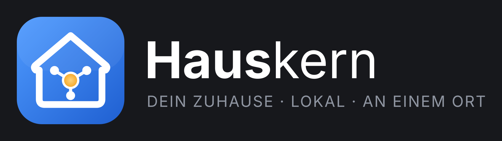

# Hauskern – dein Zuhause, lokal, an einem Ort

## Neu in Version 8.13.1: Projektseite auf GitHub 🌍

- Hauskern hat jetzt ein Zuhause: **github.com/DJLite-DE/hauskern**. Dort gibt es neue Versionen unter „Releases“.
- **„🐞 Problem melden“** öffnet jetzt direkt eine vorausgefüllte Fehlermeldung auf dieser Projektseite.
  Abgeschickt wird erst, wenn du dort selbst auf „Submit“ klickst.

## Neu in Version 8.13: Zwei-Faktor-Anmeldung 🔐

- Am Handy unter **⚙ → 🔐 Zwei-Faktor-Anmeldung** kann jeder Nutzer zusätzlich zur PIN einen **6-stelligen Code**
  einschalten. Den erzeugt eine Authenticator-App alle 30 Sekunden neu – z. B. Apple „Passwörter“ (ab iOS 18 dabei),
  Google Authenticator, Microsoft Authenticator oder 2FAS. Wer nur die PIN kennt, kommt so nicht mehr rein.
- Einrichten: QR-Code scannen (oder auf dem gleichen Handy „direkt in die App übernehmen“ tippen), ersten Code
  eintippen, fertig. Das iPhone kann den Code beim Anmelden sogar selbst vorschlagen.
- Dazu gibt es **8 Notfallcodes** zum Aufschreiben – falls das Handy mit der App mal weg ist. Jeder geht einmal;
  wird einer benutzt, kommt eine Push-Nachricht.
- Ausschalten oder neue Notfallcodes nur mit einem aktuellen Code – ein entsperrtes Handy allein reicht nicht.
- Admins können Zwei-Faktor eines Nutzers zurücksetzen (Handy: 👥 Handy-Nutzer, PC: Handy-Nutzer & Rechte →
  „2FA zurücksetzen“). Notausgang am Heimserver: `--2fa-zuruecksetzen` (siehe ANLEITUNG-HEIMSERVER.txt).
- Einstellungen vom PC an den Heimserver senden fragt jetzt nach dem Code, wenn beim Admin Zwei-Faktor an ist.
- Fürs **Wand-Display** einen eigenen Nutzer ohne Zwei-Faktor nehmen – dort gibt es nur das PIN-Feld.
- Passkeys (Anmelden mit Face ID) kommen später zusammen mit HTTPS auf dem Heimserver.

## Neu in Version 8.12.1: Freie Software (GPL-3.0) 📜 und Sicherheitshinweise 🔒

- Hauskern steht jetzt unter der **GNU GPL-3.0**: freie Software, kostenlos, ohne Gewähr. Den Lizenztext gibt es in
  `LICENSE.txt`, jede Programmdatei trägt einen kurzen Lizenz-Hinweis.
- Neu: **`RECHTLICHES.txt`** – Lizenz, Haftung, Sicherheit, Datenschutz, Marken und verwendete Fremdsoftware
  (Python, ffmpeg, OpenCV, KI-Modell YOLOX, Open-Meteo, DWD) in verständlicher Sprache.
- Neu unter ⋯ Mehr: **„📜 Lizenz & Rechtliches“**.
- Anleitung ergänzt: **Bambu Lab im LAN-Modus mit Entwicklermodus** (nötig, damit fremde Programme den Drucker
  steuern dürfen) und eine deutliche **Warnung vor Portfreigaben** – von unterwegs immer per VPN.
- Beim allerersten Start erscheint einmal ein kurzer Hinweis zu Haftung und Sicherheit.
- `README.md` für die Projektseite auf GitHub.

## Neu in Version 8.12: Zwei Varianten und unterschriebene Updates 🔏

- **„🐞 Problem melden“** öffnet eine vorausgefüllte Fehlermeldung auf der Projektseite (GitHub). Weil die
  öffentlich ist, entfernt Hauskern vorher IP-/MAC-Adressen, Namen, Pfade und Passwörter – und abgeschickt wird
  erst, wenn du dort selbst auf „Create“ klickst. Das Fehlerprotokoll liegt als ZIP auf deinem Rechner, falls du es
  anhängen möchtest.
- **Updates sind jetzt digital unterschrieben.** Hauskern installiert nur noch Pakete mit gültiger Unterschrift aus
  der offiziellen Quelle – wurde eine Datei verändert oder ist das Paket gefälscht, wird es abgelehnt. Eigene
  Sicherungen („Zurück zu einer früheren Version“) und Updates vom PC an den Heimserver gehen wie bisher.
- Updates der jeweils anderen Variante werden erkannt und nicht installiert – im Download-Ordner werden sie einfach
  übersprungen.
- Das Update findet jetzt jede ZIP, die „Hauskern“ im Namen trägt (z. B. auch „Hauskern-8.12 (1).zip“).

## Neu in Version 8.11.1: Filament-Meldung nervt nicht mehr 🧵

- **Behoben:** „Filament fast leer“ kam bei einer knappen AMS-Rolle immer wieder (ca. alle 15 Minuten). Der
  Drucker schickt zwischendurch Meldungen ohne Restmenge – Hauskern hielt das für „Rolle wieder voll“ und warnte
  danach erneut. Jetzt kommt die Meldung **genau einmal pro Rolle** – auch nach einem Neustart nicht nochmal.
  Erst wenn eine neue oder aufgefüllte Rolle im Fach steckt, wird wieder gewarnt.
- **Neu einstellbar:** ab wie viel Prozent gewarnt wird (Standard 10 %, **0 = AMS-Warnung aus**).
  Handy: ⚙ → Filament-Lager → „⚙ Warnen unter …“ · PC: Filament-Lager, unten neben „Warnen unter“.

## Neu in Version 8.10.1: Telegram-Einrichtung klappt zuverlässiger 💬

- „Chat-ID ermitteln“ findet die Nachricht an den Bot jetzt auch, wenn nur „Starten“ getippt wurde, und
  schaltet einen störenden „Webhook“ am Bot selbst ab.
- Findet es nichts, steht jetzt dabei, **welcher Bot** zum Token gehört (z. B. @mein_hauskern_bot) – so merkt man
  sofort, wenn man versehentlich einem anderen Bot geschrieben hat.
- Falscher Token wird klar gemeldet. Wurde die ganze BotFather-Nachricht eingefügt, sucht Hauskern sich den Token
  selbst heraus.
- „Telegram: Chat-ID ermitteln“ jetzt auch am Handy (⚙ → Push-Nachrichten).

## Neu in Version 8.10: 🐞 Problem melden und Anleitung für Windows, Mac & Linux

**Problem melden** – klappt etwas nicht, kann man das direkt aus Hauskern melden:
- PC: ⋯ Mehr → 🐞 Problem melden · auf der Diagnose-Seite · bei „Weitere Hersteller“ → „🐞 Klappt nicht? Melden“
  (dort ist schon eingetragen, welches Gerät und welche Fehlermeldung).
- Handy: ⚙ → 🐞 Problem melden – für **alle** Nutzer, nicht nur Admins.
- Mit „👁 Vorschau“ sieht man genau, was verschickt wird. Passwörter, PINs und Zugangscodes werden geschwärzt.
  Auf Wunsch geht das Fehlerprotokoll als Anhang mit. Eine Kopie bleibt immer auf dem eigenen Rechner – ohne
  Internet kann man die ZIP dann z. B. per WhatsApp schicken.
- Geht nur raus, wenn man selbst auf „Senden“ tippt – nie von allein.

**ANLEITUNG.txt** beschreibt die Installation jetzt von Grund auf für **Windows, Mac und Linux**, mit
Hilfe-Abschnitt für jedes System und einer Erklärung zu „Problem melden“.

## Neu in Version 8.9.2: Hilfe bei der Sky-Fehlersuche 🔎

- Findet Hauskern ein Gerät nicht, steht in der Liste jetzt dabei, wie das Gerät mit dieser IP in der FRITZ!Box heißt
  (oder dass die IP dort gar nicht vorkommt). So fällt eine falsche Adresse sofort auf.
- Ältere Sky-Software, die Tasten nur über Port 5900 annimmt, wird jetzt auch unterstützt.

## Neu in Version 8.9.1: Sky-Box wird besser gefunden 📡

- Hauskern erkennt die Sky-Box jetzt auf drei Wegen (Statusdienst, UPnP und Fernbedienungs-Port) statt nur über einen.
- Antwortet nur die Statusabfrage nicht, gehen Fernbedienung, Pause und Senderwahl trotzdem.
- Klarere Meldung, wenn die Box gar nicht antwortet (z. B. im Tiefschlaf).

## Neu in Version 8.9: Fernseher 📺 und Sky Q 📡

Sky-Box und Fernseher lassen sich jetzt **lokal im Heimnetz** steuern – ohne Cloud, ohne Zusatzgerät.
Einrichten wie die anderen Hersteller: Handy ⚙ → 🔌 Weitere Hersteller · PC: ⋯ Mehr → 🔌 Weitere Hersteller.
Adresse eintragen, „Erkennen“ tippen.

- **Sky Q** (auch Sky Q Mini): an/aus, was gerade läuft (Sendername und -nummer), Pause/Play, Spulen, Sender
  wechseln und direkt wählen, Menü-Tasten.
- **Fernseher von Vestel** – verkauft als **Hanseatic**, Telefunken, Toshiba, JVC, Hitachi, Finlux …:
  Lautstärke, Ton aus, Eingang (HDMI) wechseln, Sender, Menü-Tasten, Ausschalten.
  - Im TV-Menü **„Virtuelle Fernbedienung“** einschalten (meist unter Einstellungen → System → Mehr oder Netzwerk).
  - Einschalten aus dem echten Aus geht nur per **Wake-on-LAN**: im TV-Menü „Wake on LAN/WLAN“ einschalten.
    Die MAC-Adresse nimmt Hauskern selbst aus der FRITZ!Box. Alternativ weckt die Sky-Box den Fernseher über HDMI mit.
- **Kachel** zeigt, was läuft, mit ⏸ / ▶ und **🎛 Fernbedienung** (Handy und PC).
- **Automationen:**
  - neue Aktion „Fernseher / Sky bedienen“ (jede Taste oder „Sender wählen“).
  - „Gerät wird an/aus“ funktioniert auch mit Sky und Fernseher – z. B. „Sky geht an nach Sonnenuntergang → Licht
    dimmen“.
  - Neu bei **„Nur wenn …“: Gerät ist an/aus** – z. B. „Saugroboter nur, wenn Sky aus ist“. Geht mit allen
    schaltbaren Geräten.
- **Siri:** „Sky Pause“, „Sky weiter“, „Fernseher leiser“, „Fernseher 5 lauter“, „Ton aus“, „Sky auf Sender 102“,
  „Nächster Sender“, „Was läuft auf Sky?“, „Sky aus“. Sagst du „Sky lauter“, nimmt Hauskern automatisch den
  Fernseher (die Sky-Box selbst hat keine Lautstärke).
- **Behoben:** Beim Bearbeiten einer Automation am PC wurde bei „Nur wenn Anwesenheit …“ ungewollt das
  Zeitfenster 22–6 Uhr mit gespeichert.

## Neu in Version 8.8: Weitere Hersteller 🔌 – Shelly, Philips Hue, Tasmota, ESPHome, Zigbee

Hauskern ist nicht mehr auf FRITZ! beschränkt. Alles läuft **lokal im Heimnetz**, ohne Hersteller-Cloud.
Einrichten: Handy ⚙ → 🔌 Weitere Hersteller · PC: ⋯ Mehr → 🔌 Weitere Hersteller. Adresse (IP) eintragen,
„Erkennen“ tippen – Hauskern findet selbst heraus, was es ist. Die Gerätesuche schlägt gefundene Geräte vor.

- **Shelly** (alt und neu, auch mit Passwort): Steckdosen und Schalter mit Strommessung, Dimmer,
  Tür-/Fensterkontakte, Wasser- und Rauchmelder, Temperatur.
- **Philips Hue** über die Hue Bridge: Lampen mit Helligkeit, Bewegungsmelder (mit Temperatur), Dimmschalter.
  Koppeln: Knopf auf der Bridge drücken, dann „Hue Bridge koppeln“.
- **Tasmota** (umgeflashte Steckdosen wie Sonoff, Nous, Gosund) und **ESPHome** (Webserver muss aktiv sein).
- **Zigbee** über Zigbee2MQTT – für tausende Geräte von IKEA, Aqara, Sonoff, Hue, Tuya … Braucht den Heimserver
  mit einem Zigbee-USB-Stick; die Einrichtung dort machen wir zusammen, wenn der Mini-PC da ist.

**Alles, was Hauskern kann, gilt jetzt für alle Marken:** Kacheln am PC und Handy, Abläufe, Urlaubsmodus,
Waschmaschine & Co., Stromkosten, Heizungs-Check, Batterie-Übersicht, Siri.

**Neu für alle Marken (auch FRITZ!):**
- 🚨 **Alarm-Melder:** Wasser- und Rauchmelder schicken sofort eine dringende Push-Nachricht, die Kachel pulsiert rot.
  Türen und Fenster stehen im Logbuch – und im Urlaubsmodus gibt es eine Push, wenn eine Tür aufgeht.
- 🔘 **Taster als Auslöser** (z. B. FRITZ!DECT 440, Hue-Dimmschalter, IKEA-Taster): neuer Ablauf-Auslöser
  „Melder / Taster“ – auch für Tür auf/zu, Bewegung, Wasser und Rauch.
- 💡 **Lampen dimmen** (auch FRITZ!DECT 500): − / + auf der Kachel, neue Ablauf-Aktion „Lampe dimmen“,
  Siri: „Esstisch auf 30 Prozent“.
- Siri versteht Melder: „Ist die Haustür offen?“

## Neu in Version 8.7: Unwetterwarnungen vom Deutschen Wetterdienst ⛈

- Amtliche Warnungen des DWD **für deine Gemeinde** (nicht nur den Kreis): Gewitter, Sturm, Glätte, Schnee,
  Starkregen, Nebel, Hitze, Frost.
- Farbiger Balken oben in der Handy-App (gelb → orange → rot → violett, wie beim DWD), antippen für
  Beschreibung und Verhaltenstipps. Auf der Wetterkachel (Handy und PC) steht die wichtigste Warnung.
- Push-Nachricht standardmäßig ab „markantes Wetter“ (orange), einstellbar unter Wetter. Jede Warnung kommt
  nur einmal – verschärft sie sich, kommt eine neue Nachricht, bei Verlängerungen nicht.
- Siri: „Gibt es eine Unwetterwarnung?“
- Kostenlos und ohne Konto, direkt vom Geodienst des Deutschen Wetterdienstes; alle 10 Minuten abgefragt.

## Neu in Version 8.6: Frischer, weicher Look ✨

**Handy**
- Ruhigere, weichere Farben mit einem sanften Farbschimmer im Hintergrund.
- Rundere Kacheln mit leichtem Schatten. Aktive Kacheln (an, läuft) leuchten dezent blau.
- Fenster wie Einstellungen, Verlauf oder Listen gleiten weich von unten herein.
- Kacheln und Knöpfe geben beim Antippen nach, Schalter gleiten sanfter, Eingabefelder leuchten beim Tippen.
- Wer in iOS „Bewegung reduzieren“ eingeschaltet hat, bekommt keine Animationen.

**PC**
- Dieselben weicheren Farben wie am Handy.
- Kacheln mit sanftem Schatten, die beim Drüberfahren mit der Maus leicht aufhellen.
- Schalter auf den Kacheln gleiten jetzt zur anderen Seite, statt zu springen.
- Das Fenster blendet beim Start weich ein, und die aktive Seite im Menü ist fett hervorgehoben.

## Neu in Version 8.5: Urlaubsmodus 🏖 und „Waschmaschine fertig“ 🧺

**Urlaubsmodus** (Handy: Kachel bei Personen · PC: ⋯ Mehr → 🏖 Urlaubsmodus · Siri: „Urlaubsmodus an“)
- **Licht wie zu Hause:** Ausgewählte Lampen an FRITZ!DECT-Steckdosen gehen abends an – kurz nach
  Sonnenuntergang oder zu einer festen Zeit – und gegen 23 Uhr wieder aus. Jeden Abend und für jede Lampe
  zu leicht anderen Zeiten, damit es nicht nach Zeitschaltuhr aussieht.
- **Heizung sparen:** Heizkörperregler bleiben höchstens auf 16 °C (einstellbar). Mit Rückkehrdatum heizt
  Hauskern rechtzeitig vorher wieder auf die alten Werte – warm, wenn ihr ankommt.
- **Kamera-Push mit Bild**, wenn jemand vor der Kamera steht (mit Kamera-Erkennung nur bei Personen).
- **Endet von selbst**, sobald jemand mit Handy nach Hause kommt, oder zur Rückkehrzeit.
- Oben in der Handy-App steht ein Hinweis, solange er läuft. Einschalten darf, wer „Zuhause steuern“ darf.

**Waschmaschine & Co.** (Handy: ⚙ → 🧺 Waschmaschine & Co. · PC: ⋯ Mehr)
- Hängt Waschmaschine, Trockner oder Spülmaschine an einer FRITZ!DECT-Messsteckdose, erkennt Hauskern am
  Stromverbrauch, wann das Programm fertig ist: „🧺 Waschmaschine ist fertig – Lief 1:52 Std. · 0,9 kWh · ≈ 0,32 €“.
- Pausen (Einweichen, Trocknen) lösen keinen Fehlalarm aus. Optional eine Erinnerung, wenn nicht ausgeräumt wurde.
- Kachel am Handy: „läuft seit 47 Min.“ bzw. „✔ fertig seit 12 Min.“ · Siri: „Ist die Waschmaschine fertig?“

**Behoben**
- Siri hat bei Fragen geschaltet: „Ist die Stehlampe an?“ hat die Lampe eingeschaltet. Fragen werden jetzt
  nur beantwortet.

## Neu in Version 8.4: Kamera-Aufnahmen aufs Handy 🎥 und SSD-Check 💽

**Kamera-Aufnahmen** (Handy: Kameras → 🎥 Aufnahmen · PC: ⋯ Mehr → 🎥 Kamera-Aufnahmen)
- Alle Aufnahmen aus dem Kamerafenster und aus Abläufen („Kamera-Aufnahme“, z. B. wenn eine Person erkannt wird)
  jetzt auch auf dem Handy: abspielen, herunterladen, löschen – für alle oder nur für eine Kamera.
- Ältere Aufnahmen räumt Hauskern selbst weg: standardmäßig höchstens 10 GB und 30 Tage, einstellbar.
  Die neueste Aufnahme bleibt immer, laufende Aufnahmen werden nie angefasst.
- Löschen dürfen nur Nutzer mit Recht „Kameras: ändern“ – „Nur ansehen“ kann gucken, aber nichts löschen.

**SSD-Check** (Heimserver)
- Hauskern liest alle 6 Stunden die Selbstdiagnose der SSD und meldet sich per Push, bevor sie kaputtgeht:
  Verschleiß, Lesefehler oder „SSD meldet Defekt“. Auch wenn Linux das Laufwerk wegen Fehlern
  schreibgeschützt macht, kommt eine Warnung.
- Zu sehen in der Heimserver-Kachel am Handy („SSD gut · 96 % Lebensdauer übrig“) und in der Diagnose.
- Wird beim Einrichten des Heimservers (install.sh) automatisch mit eingerichtet. Auf Windows zeigt Hauskern,
  was Windows selbst über die Laufwerke weiß.

**Behoben**
- Hauskern startete nicht mehr, sobald unter „Personen & Gegenstände“ ein **Gegenstand** (z. B. Uhr oder Auto)
  eingetragen war.

## Neu in Version 8.3: Einkaufsliste 🛒 und Wand-Display 🖼

**Einkaufsliste & Aufgaben** (Handy: Bereich „Listen“ · PC: Kachel bei Personen oder ⋯ Mehr)
- Gemeinsame Listen für die ganze Familie – was einer einträgt, sehen alle sofort.
- Mehrere Sachen auf einmal: „Milch, Eier und Brot“. Steht schon drauf? Dann kommt es nicht doppelt.
- Antippen = abhaken. Erledigte verschwinden nach 7 Tagen von selbst.
- **Siri:** „Milch und Eier auf die Liste“, „Was steht auf der Einkaufsliste?“, „Was brauchen wir?“,
  „Eier gekauft“, „Fenster putzen auf die Aufgabenliste“.
- Eigenes Recht „Einkaufsliste & Aufgaben“ – alle bisherigen Familienmitglieder dürfen sie sofort benutzen.

**Wand-Display** (Adresse: …:8770/wand · Anleitung: ⚙ → 🖼 Wand-Display)
- Ein altes Tablet wird zum Info-Bildschirm: große Uhr, Wetter, Termine, wer zu Hause ist,
  Einkaufsliste zum Abhaken, Drucker-Fortschritt, Szenen-Knöpfe und Hinweise (verpasste Anrufe, Batterien …).
- Nachts (22–6 Uhr) gedimmt mit großer Uhr, Antippen weckt es kurz auf. Gegen Einbrennen wandert der Inhalt
  alle paar Minuten ein kleines Stück.
- Tipp: einen eigenen Nutzer „Wand“ mit „Nur ansehen“ anlegen – dann kann am Tablet niemand etwas umstellen.

**Kleinigkeiten**
- Die Anmeldung am Handy verlängert sich jetzt bei jeder Benutzung – wer Hauskern regelmäßig nutzt, muss die PIN
  nie wieder eingeben.

## Neu in Version 8.2: Kamera-Erkennung 🧠, Fehldruck-Wächter 🍝 und Erweiterungen 🧩

**Kamera-Erkennung** (standardmäßig aus · ⋯ Mehr → 🧠 Kamera-Erkennung, am Handy unter ⚙)
- Bei Bewegung schaut Hauskern aufs Kamerabild und erkennt **Person, Katze, Hund, Vogel oder Fahrzeug** –
  komplett lokal, nichts geht ins Internet. Kachel und Logbuch zeigen, was gesehen wurde („● Person erkannt“).
- In Automationen gibt es beim Auslöser „Kamera“ jetzt das Feld **„Was“**: jede Bewegung, eine Person, ein Tier,
  eine Katze, einen Hund, ein Fahrzeug. Zusammen mit „Hinweis mit Kamerabild“ bekommst du z. B. nur dann eine
  Push-Nachricht mit Foto, wenn wirklich ein Mensch im Garten steht – keine Fehlalarme mehr durch Schatten oder Regen.
- Läuft auf dem Heimserver (Raspberry Pi 5 oder Mini-PC). install.sh installiert dafür OpenCV. Das KI-Modell
  (YOLOX aus dem OpenCV-Modellzoo, Apache-2.0, ca. 36 MB) wird beim Einschalten einmal geladen und mit der
  offiziellen Prüfsumme geprüft.

**Fehldruck-Wächter** (automatisch, bei Druckern mit KI-Kamera wie dem X2D)
- Meldet die KI im Drucker „Spaghetti“, kommt sofort eine Push-Nachricht **mit Foto** – einmal pro Druck.
- Am Handy steht beim Drucker, ob die KI-Überwachung an ist und ob der Drucker bei Fehlern pausiert.
- Hauskern stellt dabei nichts am Drucker um.

**Erweiterungen** (⋯ Mehr → 🧩 Erweiterungen, am Handy unter ⚙ für Admins)
- Kleine Zusatzdateien bringen eigene Kacheln, Siri-Befehle und Abläufe mit – ohne dass Hauskern selbst
  größer wird. Zwei Beispiele zum Ausprobieren: „Sonnenzeiten“ und „Druckstatistik“.
- Sicherheit: Eine Erweiterung läuft erst, wenn du sie freigibst. Ändert sich die Datei, ist sie wieder aus,
  bis du sie erneut freigibst.

**Behoben**
- Am Handy öffnete der 🧮 Kosten-Rechner seit 8.0 im Fenster der Anrufliste. Ab jetzt prüft ein automatischer
  Test vor jeder Version, dass es keine doppelten Namen mehr gibt.

## Neu in Version 8.1: Heimserver auf jedem Linux 🖥 und Setup mit einem Klick 🪄

**Heimserver: Raspberry Pi oder Mini-PC**
- Hauskern läuft jetzt genauso auf einem Mini-PC (Intel/AMD) mit Debian, Ubuntu oder Linux Mint wie auf dem Pi.
- install.sh erkennt das Gerät, prüft die Python-Version, installiert alles Nötige und gibt bei aktiver
  Firewall (ufw/firewalld) den Port nur fürs Heimnetz frei.
- Die Gesundheits-Kachel zeigt beim Mini-PC Hersteller und Modell (z. B. „Lenovo ThinkCentre M720q“),
  die CPU-Temperatur (Intel und AMD) mit passenden Grenzwerten und ob die SSD per SATA oder USB hängt.
- In der App heißt der Rund-um-die-Uhr-Rechner jetzt „Heimserver“ (⋯ Mehr → Heimserver (Pi/Mini-PC)).
- Neue Schritt-für-Schritt-Anleitung: ANLEITUNG-HEIMSERVER.txt

**Windows: Hauskern-Setup.cmd**
- Doppelklick genügt: Fehlt Python, installiert das Setup es automatisch (python.org oder winget,
  Signatur wird geprüft), legt eine Desktop-Verknüpfung an und startet Hauskern.
- Liegt ein Python-Installer im Hauskern-Ordner, nimmt das Setup den – ganz ohne Internet.
- ANLEITUNG.txt ist entsprechend kürzer geworden.

## Neu in Version 8.0: Anrufliste 📞, Wochenrückblick 📅 und „Was ist neu?“ 📰

**Anrufliste** (nur mit FRITZ!Box · Handy: Bereich „Telefon“ · PC: ⋯ Mehr → 📞 Anrufliste)
- Alle Anrufe der letzten Zeit – verpasst, angenommen, ausgehend, auf dem Anrufbeantworter (📼 mit Nachricht).
- **Push-Nachricht bei verpassten Anrufen**, mit Namen aus dem Telefonbuch der FRITZ!Box.
- Am Handy auf 📲 tippen → ruft direkt zurück.
- Siri: „Wer hat angerufen?“
- Eigenes Recht „Anrufliste“: Admins sehen sie sofort, alle anderen erst, wenn du es ihnen unter Handy-Nutzer
  freigibst – Anrufe sind privat.
- Falls „Keine Berechtigung“ erscheint: In der FRITZ!Box beim Benutzer von Hauskern das Recht
  „Sprachnachrichten, Faxnachrichten, FRITZ!App Fon und Anrufliste“ anhaken.

**Wochenrückblick** (standardmäßig aus · einschalten unter Push-Nachrichten)
- Sonntags um 18 Uhr eine kurze Push-Nachricht: Strom im Monat, Drucke der Woche, knappes Filament,
  Batterien, die bald leer sind, verpasste Anrufe, Hinweise vom Heizungs-Check.

**Was ist neu?**
- Nach jedem Update zeigt Hauskern einmal, was dazugekommen ist – am PC als Fenster, am Handy als Hinweis oben.
  Praktisch, wenn die Familie mittestet. Später wieder unter ⋯ Mehr → 📰 Was ist neu?

**Raspberry Pi**
- install.sh prüft die Zeitzone und bietet „Europe/Berlin“ an (Raspberry Pi OS steht oft auf London – dann
  lägen Automationen und Heizzeiten eine Stunde daneben). Auch die Diagnose meldet das jetzt.
- Hauskern startet auf dem Pi erst, wenn die Uhrzeit aus dem Internet geholt wurde (der Pi hat keine Uhr mit Batterie).

**Behoben**
- Am Handy öffnete der 📈 Verlauf seit 7.9 den Heizungs-Check statt der Diagramme.
- Kamera nicht erreichbar / Netzwerksuche fehlgeschlagen: Statt der Fehlermeldung gab es einen zweiten Fehler.
- Einstellungen speichern ist jetzt sicher, auch wenn Handy und PC gleichzeitig speichern.
- Ein Fehler in einer Handy-Anfrage zeigt jetzt eine verständliche Meldung statt „keine Verbindung“.
- Kleinigkeiten: „1 Messsteckdose“ statt „1 Messsteckdosen“.

## Neu in Version 7.9: Siri 🗣, Heizungs-Check 🔥 und aufgeräumte Seitenleiste

**Siri-Kurzbefehle**
- „Hey Siri, Hauskern“ → „Schreibtisch aus“, „Wohnzimmer auf 21 Grad“, „Wie weit ist der Drucker?“, „Wer ist zu
  Hause?“, „Starte Feierabend“, „Gast-WLAN an“, „Stromverbrauch“, „Batterien“, „Filament“ – Siri liest die Antwort vor.
- Einrichten am iPhone: Hauskern → ⚙ → 🗣 Siri-Kurzbefehle (Anleitung + Adresse zum Kopieren + „Ausprobieren“).
- Jeder Handy-Nutzer hat seinen eigenen Schlüssel, es gelten seine Rechte. „Neuer Schlüssel“ sperrt den alten sofort.
- Unterwegs mit WireGuard. Alles läuft lokal, nichts geht über fremde Server.

**Heizungs-Check** (Kachel bei Smart Home · PC: ⋯ Mehr → 🔥 Heizungs-Check)
- Hinweise aus dem Temperaturverlauf der letzten 7/14/30 Tage, pro Raum: Aufheizzeit, wird nicht richtig warm,
  Nachtabsenkung, Heizen während niemand da ist, Fenster lange offen beim Heizen, kühlt schneller aus als andere Räume.
- Hauskern stellt nichts um – es sind nur Hinweise.
- „Fenster offen“ zeichnet Hauskern ab jetzt auf, dieser Teil wird also nach ein paar Tagen aussagekräftig.

**Aufgeräumt:** Alle Extras am PC stecken jetzt unter **⋯ Mehr** in der Seitenleiste.

**Behoben:** In 7.8 ließ sich im Druckkosten-Rechner das Fenster „Filament bearbeiten“ nicht mehr öffnen.

## Neu in Version 7.8: Filament-Lager 🧵 und Batterie-Übersicht 🔋

**Filament-Lager** (Handy: Kachel im Bereich 3D-Druck · PC: Klick auf die AMS-Kachel oder Rechtsklick auf den Drucker)
- Alle Spulen mit Material, Farbe, Restmenge, Lagerort und AMS-Fach.
- **Bambu-Rollen mit Chip** erkennt Hauskern im AMS – einmal „➕ Neu im AMS – übernehmen“ antippen, ab dann kommt die
  Restmenge direkt vom Drucker.
- **Andere Rollen:** Nach jedem Druck zieht Hauskern den Verbrauch automatisch ab (bei Abbruch nur den gedruckten Teil).
- **Nachwiegen:** Einmal das Gewicht der leeren Spule eintragen, dann reicht „Spule mit Filament wiegen“ – Hauskern
  rechnet den Rest aus. Verbrauch an anderen Druckern lässt sich von Hand abziehen.
- Wird eine Spule knapp (Standard unter 150 g), kommt einmal eine Push-Nachricht. Die Warnung „Filament reicht
  evtl. nicht“ beim Druckstart kennt jetzt auch die Restmengen von Rollen ohne Chip.
- Auch für Familienmitglieder mit Recht „3D-Drucker steuern“ – nicht nur für Admins.

**Batterie-Übersicht** (Kachel im Bereich Smart Home)
- Alle FRITZ!DECT-Geräte mit Batterie, sortiert nach „wird zuerst leer“.
- Hauskern merkt sich jeden Tag den Stand, erkennt Batteriewechsel und schätzt, wie lange es noch reicht.
- Etwa **drei Wochen vorher** kommt eine Erinnerung – nicht erst, wenn die FRITZ!Box „schwach“ meldet.

**Behoben:** Rechtsklick „🎬 Zeitraffer für diesen Druck einschalten“ am PC hat nichts getan.

## Neu in Version 7.7: Aufs Handy per QR-Code 📱

- Seitenleiste → **📱 Aufs Handy** (oder Einstellungen → „📱 Adresse & QR-Code“): Mit der iPhone-Kamera
  abscannen, schon ist Hauskern offen. Die Adresse lässt sich auch kopieren.
- Hat der PC mehrere Netzwerkkarten, steht die Heimnetz-Adresse automatisch oben.
- Beim Einschalten des Handy-Zugriffs erscheint der QR-Code direkt.

## Neu in Version 7.6: Zeitraffer vom 3D-Drucker 🎬

- **Standardmäßig aus.** Pro Drucker wählst du: „aus“, „nur wenn ich ihn einschalte“ oder „jeden Druck“.
  Am PC: Seitenleiste → 🎬 Zeitraffer. Am Handy: ⚙ → 🎬 Zeitraffer.
- **Nur für einen Druck:** Bei „nur wenn ich ihn einschalte“ tippst du am Handy beim Drucker auf
  „🎬 Zeitraffer“ (am PC: Rechtsklick auf die Drucker-Kachel). Das gilt dann genau für diesen einen Druck
  und schaltet sich danach von selbst wieder aus.
- **Ein Bild pro Schicht**, aus der Druckerkamera oder einer deiner Kameras. Druckt der Drucker ohne
  Schichtangabe, gibt es alle 20 Sekunden ein Bild (einstellbar).
- **Am Ende macht Hauskern das Video** (H.264, läuft auf jedem Handy) und **löscht die Einzelbilder sofort**.
  Du bekommst eine Push-Nachricht „🎬 Zeitraffer fertig“. Bei abgebrochenen Drucken mit zu wenigen Bildern
  wird nichts gespeichert.
- **Speicher im Griff:** Höchstgrenze (Standard 5 GB) und „löschen nach … Tagen“ (Standard 60). Darüber
  fliegen die ältesten Videos raus, das neueste bleibt immer. Videobreite 1280 px (spart Platz) oder Full HD.
- **Videos am Handy** ansehen, herunterladen oder löschen: beim Drucker „🎬 Videos“.
- Ordner: `Videos/Hauskern/Zeitraffer`. Auf dem Pi landen sie mit auf der SSD.

## Neu in Version 7.5: Sicherheitspaket für den Raspberry Pi 💾🍓

### 💾 Automatische Sicherung (Seitenleiste → Sicherung · Handy: ⚙ → Sicherung)
- **Jede Nacht** (Standard 03:30) – Einstellungen, Verlauf, Druck- und Stromdaten. Die Datenbank wird auch im
  laufenden Betrieb stimmig gesichert. Behalten: **7 Tage + 4 Wochen + 5 manuelle**.
- **Zweiter Ort – Netzwerkspeicher (z. B. SSD an der FRITZ!Box):** Hauskern lädt jede Sicherung über den
  eingebauten Dateizugang der FRITZ!Box hoch (verschlüsselt, wenn die Box es anbietet) und behält dort die
  letzten 14. Am Pi muss dafür nichts eingehängt werden.
  - FRITZ!Box: Heimnetz → USB/Speicher → Speicher (NAS) aktiv + Zugriff über FTP einschalten
  - FRITZ!Box-Benutzer mit dem Recht „Zugang zu NAS-Inhalten“ (lesen und schreiben)
  - Ordner z. B. `Samsung-SSD/Hauskern-Sicherung` – „Netzwerkspeicher testen“ zeigt die Laufwerke an
- **Optional:** zusätzlicher Ordner (USB-Stick) und/oder der PC holt sich täglich eine Kopie vom Pi.
- **Wiederherstellen** mit einem Klick (auch am Handy) oder aus einer Datei. Die jetzigen Daten werden vorher
  in `vor-wiederherstellung-…` gelegt, Hauskern startet neu. Fehlgeschlagene Sicherungen melden sich per Push.

### 📜 Logbuch am Handy
- „**X Neuigkeiten seit …**“ oben auf der Startseite – antippen, und du siehst, was passiert ist, während
  du weg warst. Filter nach Bereich, Suche, neue Einträge sind markiert.
- Jeder sieht nur das, was er laut seinen Rechten sehen darf.

### 🍓 Gesundheit des Raspberry Pi
- Temperatur, **Unterspannung** (schwaches Netzteil), Speicherplatz und Speicherart (SD-Karte / USB-SSD /
  NVMe) – als Kachel am Handy und in der Diagnose („Rechner & Sicherung“).
- **Push**, wenn es kritisch wird (zu heiß, zu wenig Strom, Speicher fast voll) – ohne Dauerfeuer.

## Neu in Version 7.4: Alexa & Google Home vorbereiten 🎙

Seitenleiste → **🎙 Alexa & Google** (am Handy: ⚙ → Alexa & Google Home)

- Du wählst, **was** Alexa und Google Home sehen dürfen und **wie es dort heißt**:
  Steckdosen/Schalter/Lampen, Heizkörperregler, Szenen, Anwesenheit und 3D-Drucker.
- Nur Freigegebenes ist sichtbar. Doppelte Namen erkennt Hauskern gleich beim Speichern.
- Die Verbindung läuft **lokal über Matter** (Echo Dot und Nest Mini können das) – ohne Cloud-Skill,
  ohne Hauskern im Internet. Dafür kommt mit dem Raspberry Pi ein kleines Zusatzprogramm
  (Matterbridge + Hauskern-Plugin). Bis dahin ist hier alles vorbereitet.

Was später per Sprache geht:
- „Alexa, Schreibtisch aus“ · „Hey Google, Wohnzimmer auf 21 Grad“ · „Alexa, Feierabend an“
- Anwesenheit und „Drucker druckt“ als Sensoren für Routinen in der Alexa-/Google-App
  (z. B. Ansage, wenn der Druck fertig ist)

Technisch: Die Bridge fragt `/api/bridge` mit einem eigenen Schlüssel ab – nur aus dem Heimnetz und nur,
solange die Freigabe eingeschaltet ist. Jeder Sprachbefehl steht im Logbuch.

## Neu in Version 7.3: Alles auch vom Handy – bereit für den Raspberry Pi 📱🍓

### ⚙ Einstellungen am Handy (oben rechts)
- **Automationen:** ansehen, an/aus, **neu anlegen und bearbeiten** – Auslöser, „Nur wenn …“ (Zeitfenster, Tage,
  Anwesenheit) und beliebig viele Aktionen (sortierbar). Szenen lassen sich mit ▶ starten.
  Neues Recht für Handy-Nutzer: **Automationen** (ansehen / steuern = ändern).
- **Für Admins:** Router, Personen & Gegenstände, Geräte, 3D-Drucker, Kameras, Handy-Nutzer & Rechte,
  Push-Nachrichten (mit „Test senden“), Strompreis & Warnungen, Wetter.
- **✨ Geführte Einrichtung** am Handy: Router → Personen → Drucker → Kameras → Push.

### Raspberry Pi ohne PC einrichten
Frisch installierter Pi ohne Einstellungen? Einfach `http://<pi>:8770` im Handy öffnen:
Hauskern begrüßt dich, du legst Name + PIN an (geht nur im Heimnetz und nur, solange noch niemand
eingerichtet ist) – danach führt die Einrichtung durch den Rest. Der Weg über den PC geht weiterhin.

### Unterwegs
- **Keine Verbindung?** Statt einer leeren Seite zeigt Hauskern den **letzten Stand** mit Uhrzeit, Schalter
  sind solange ausgegraut. (Passwörter wie das Gast-WLAN werden dafür nicht auf dem Handy gespeichert.)
- **„Unterwegs? VPN einschalten ›“** erklärt Schritt für Schritt, wie das iPhone per WireGuard automatisch
  ins Heimnetz kommt, sobald du das WLAN verlässt (FRITZ!Box-VPN + „Bei Bedarf aktivieren“).
- Hinweis: Wird die Seite unterwegs ganz neu geöffnet, während das VPN aus ist, zeigt Safari nur einen
  Fehler – der gespeicherte Stand erscheint, wenn Hauskern schon offen war.

Außerdem: Nach der Anmeldung am Handy ging die allererste Anfrage manchmal noch als „nicht angemeldet“
durch – behoben.

## Neu in Version 7.2: Auch ohne FRITZ!Box 📡

Der Einrichtungs-Assistent fragt jetzt zuerst nach dem **Router** – und erkennt ihn meist selbst:

| | FRITZ!Box | Anderer Router | Ohne Router |
|---|---|---|---|
| Internet online/offline, Benachrichtigung | ✅ | ✅ | – |
| Externe IP, Datenrate, Verlauf | ✅ | ✅ mit UPnP | – |
| Geräte im Netz, Anwesenheit, Gerätesuche | ✅ | ✅ | nur Gerätesuche |
| Wake-on-LAN | ✅ | ✅ | ✅ |
| WLAN & Gast-WLAN schalten, QR-Code | ✅ | – | – |
| FRITZ!DECT (Steckdosen, Heizung), Stromkosten | ✅ | – | – |
| 3D-Drucker, Kameras, Kalender, Wetter, Druckkosten | ✅ | ✅ | ✅ |

- **Erkennung:** erst FRITZ!Box, dann fragt Hauskern den Router per UPnP nach seinem Modell (Speedport,
  Vodafone Station, o2 HomeBox, TP-Link, ASUS …), sonst steht der Titel der Router-Oberfläche da.
- **Anderer Router** braucht keine Zugangsdaten. Die Geräteliste kommt aus der Netzwerkliste des PCs
  (Hauskern „stupst“ dafür alle 45 Sekunden kurz die Adressen im Heimnetz an).
- Umstellen jederzeit: Einstellungen → Router, oder Seitenleiste → ✨ Einrichtung.
- Die Diagnose prüft beim anderen Router Erreichbarkeit, UPnP, Internet und Geräteliste.

## Installation auf einem neuen PC 🧩

Die ausführliche Schritt-für-Schritt-Anleitung (auch zum Weitergeben) steht in **ANLEITUNG.txt**. Kurz:

1. **Python installieren** (einmalig): Eingabeaufforderung öffnen und `winget install Python.Python.3.13`
   eintippen – oder den Installer von https://www.python.org/downloads/ nehmen (Haken bei
   „Add python.exe to PATH“). Bitte nicht die Version aus dem Microsoft Store.
2. **Hauskern.zip auspacken**, z. B. nach `Dokumente\Hauskern`, und `Hauskern.pyw` doppelt anklicken.
3. Der **Einrichtungs-Assistent** führt durch den Rest (FRITZ!Box-Benutzer, Geräte, Handy …).

Mehr braucht es nicht: Hauskern kommt ohne Zusatzpakete aus, und ffmpeg für die Kameras lädt es selbst.
Die Zip enthält keine persönlichen Daten – Einstellungen liegen auf jedem PC unter `%APPDATA%\Hauskern`.

## Neu in Version 7.1: Einrichtungs-Assistent & mehrere Handy-Nutzer ✨👥

### Einrichtungs-Assistent (Seitenleiste → ✨ Einrichtung)
Startet beim allerersten Start von selbst und führt durch:
1. **FRITZ!Box** – wird automatisch gefunden, Zugangsdaten werden direkt geprüft
2. **Geräte im Netz** – 3D-Drucker, Kameras und andere Geräte mit einem Klick einrichten
3. **Wer wohnt hier?** – Handys als Personen für die Anwesenheit
4. **Handy-Zugang** – erster Nutzer mit PIN, dazu ein **QR-Code** zum Öffnen auf dem Handy
5. **Wetter & Push**
6. **Übersicht**, was eingerichtet ist

Jeder Schritt lässt sich überspringen. Der Assistent legt nichts von selbst an – und nie Automationen.

### Mehrere Handy-Nutzer (Einstellungen → 👥 Handy-Nutzer & Rechte)
- Jeder bekommt **eine eigene PIN** – daran erkennt Hauskern, wer sich anmeldet.
- **Rechte pro Bereich:** aus · ansehen · steuern – für Personen & Termine, Smart Home & Szenen, Kameras,
  3D-Drucker, Netzwerk & WLAN, Stromkosten, Druckkosten-Rechner, Verlauf und Diagnose.
- **Vorlagen:** Vollzugriff · Alles sehen, Zuhause steuern · Nur ansehen · Eingeschränkt (z. B. Kinder)
- **Admins** dürfen alles, auch die Einstellungen an den Raspberry Pi senden. Mindestens einer bleibt immer Admin.
- Was jemand nicht sehen darf, fehlt auf seinem Handy komplett. „Ansehen“-Bereiche zeigen alles, aber
  ohne Schalter. Hauskern prüft die Rechte auch auf dem Server, nicht nur in der Anzeige.
- Im **Logbuch** steht, wer am Handy was geschaltet hat.
- **Überall abmelden** pro Nutzer. Eine neue PIN meldet seine Handys ebenfalls ab.
- Am Handy oben rechts: 👤 Name – antippen zum Abmelden.

**Deine bisherige PIN gilt weiter:** Sie wird automatisch zum Admin „Hauptnutzer“ – benenne ihn einfach um.
Der Raspberry Pi bekommt die Nutzer mit „Einstellungen an den Pi senden“.

## Neu in Version 7.0: Gast-WLAN mit QR-Code & Stromkosten-Überwachung 📶⚡

### Gast-WLAN
- Eigene Kachel **Gast-WLAN** (Zuhause → Netzwerk und auf dem Handy): ein Tipp schaltet es an oder aus.
- **QR-Code** zum Scannen – Gäste halten nur die Handykamera drauf und tippen „Verbinden“.
- **Automatisch ausschalten** nach 1, 3, 6, 12, 24 Stunden oder 3 Tagen, wenn du das beim Einschalten so wählst
  (Standard: bleibt an, bis du es ausschaltest).
- **Druckversion** (am PC: 🖨 Druckversion, am Handy: Drucken) – z. B. fürs Gästezimmer.
- **Neues Passwort** mit einem Klick (verbundene Gäste müssen danach neu scannen).
- Hauskern erkennt das Gast-WLAN selbst (Name mit „Gast/Guest“ oder das letzte WLAN der FRITZ!Box).
  Falls es danebenliegt: WLAN → 📶 Gast-WLAN & QR-Code → „Welches WLAN ist das Gast-WLAN?“.

### Stromkosten (Energie-Seite)
- **Dieser Monat, Hochrechnung, letzter Monat, letzte 12 Monate** – in Euro und kWh.
- **Kosten pro Monat** als Diagramm (Umschalter „30 Tage / 12 Monate“). Die Monatswerte holt Hauskern von der
  FRITZ!Box – damit siehst du auch Monate von **vor** Hauskern.
- Pro Gerät: Monat bisher, Hochrechnung, Vormonat, **Trend** (📈/📉 ggü. dem Schnitt der letzten 3 Monate) und
  **Grundlast** (was das Gerät dauerhaft zieht, mit Kosten pro Jahr).
- **⚙ Strompreis & Warnungen:** Arbeitspreis, optionales **Monatsbudget** und Benachrichtigungen:
  Monatsbericht am 1., Warnung bei ungewöhnlich hohem Verbrauch eines Geräts, Warnung bei Budget-Überschreitung.
- Auf dem Handy: Tipp auf die Verbrauchs-Kachel → ⚡ Stromkosten.

Gemessen wird alles, was an einer FRITZ!DECT-Messsteckdose hängt.

## Neu in Version 6.9: Geräte einfach hinzufügen – mit Erkennung 🔎

Überall, wo Geräte aus dem WLAN/LAN auftauchen (**Gerätesuche** und **Geräte-Liste**), gibt es jetzt
**„＋ Zu Hauskern hinzufügen …“**. Hauskern sagt dir vorher:

- **was es ist** (z. B. „TV-Box (Sky)“, „Rauchmelder-Basisstation“, „Spielkonsole“, „Handy/Tablet“)
- **wie es genutzt werden sollte** – Handys werden als *Person* vorgeschlagen (auch Geräte mit privater
  WLAN-Adresse, die typisch für Handys ist), Uhr und Auto als *Gegenstand*, alles andere als *Gerät*
- **was dazugehört** – z. B. die Sky-Q-Mini-Boxen zur Sky-Hauptbox oder WLAN-Rauchmelder zur Station.
  Passende Geräte sind schon vorausgewählt, alles andere kannst du dazunehmen.
- ob es **schon in Hauskern** steckt

**Geräte bekommen eine eigene Kachel** (Zuhause → Geräte, auch auf dem Handy): online/offline und wie viele der
verbundenen Geräte erreichbar sind („⚠ offline: Sky Mini Bad“). Wechsel landen im Logbuch.

**Basisstationen** (Rauchmelder, Zigbee, Homematic, Kamera-Basen …): Was per Funk an der Station hängt, ist im Netz
nicht sichtbar. Du kannst diese Geräte beim Hinzufügen für die Übersicht eintragen („3 per Funk“).

Auch im Dialog **Personen & Gegenstände** schlägt Hauskern jetzt automatisch die passende Art vor, sobald du ein
Gerät anklickst. Wenn du die Art selbst änderst, bleibt deine Wahl.

Wie immer: Hauskern legt dabei **keine Automationen** an.

## Neu in Version 6.8: Updates mit einem Klick ⬆️

**Ab jetzt nie mehr entpacken und drüberkopieren:**

1. Neue `Hauskern.zip` einfach herunterladen (bleibt im Download-Ordner oder auf dem Desktop liegen).
2. Hauskern starten → es fragt: *„Neue Version X gefunden – jetzt installieren?“*
3. **Ja** → Hauskern installiert, sichert vorher die alte Version und startet von selbst neu.

Einstellungen, Verlauf, Druckdaten und ffmpeg bleiben dabei unangetastet (die liegen in `%APPDATA%\Hauskern`).
Ein kaputtes oder älteres Paket wird abgelehnt, bevor irgendetwas überschrieben wird.

**SYSTEM → ⬆ Updates**
- im Download-Ordner suchen oder eine Update-Datei von woanders wählen
- **zurück zu einer früheren Version** (die letzten 5 werden aufgehoben)
- automatische Suche beim Start ein/aus

**Raspberry Pi:** Der PC prüft beim Start, ob der Pi älter ist, und schickt ihm das Update automatisch.
Abgesichert mit einem geheimen Schlüssel, den nur PC und Pi kennen (kommt mit „Einstellungen an den Pi senden“ rüber).
Der Pi startet danach von selbst neu.

> Einmalig: Diese Version 6.8 musst du noch wie gewohnt von Hand installieren – ab dann übernimmt Hauskern das.

## Neu in Version 6.7: AMS-Anzeige & Druckkosten auf dem Handy 🧵

### AMS (auch AMS 2 Pro, AMS HT und externe Spule)
- Auf **Zuhause** (Bereich 3D-Druck) gibt es pro AMS eine Kachel mit allen Fächern: **Füllstand** wie im Bambu Studio, Filamenttyp, Farbe und ungefähre **Restmenge in Gramm**. Das aktive Fach ist markiert ▼.
- Oben in der Kachel stehen **Luftfeuchte**, Temperatur und beim AMS 2 Pro die **restliche Trocknungszeit**.
- Den Füllstand kennt der Drucker nur bei **Bambu-Rollen mit RFID-Chip**. Bei anderen Rollen zeigt Hauskern „?“, genau wie der Drucker selbst.
- **Push „Filament fast leer“**, sobald eine Rolle unter 10 % fällt (einmal pro Rolle).
- **Reicht das Filament?** Beim Druckstart vergleicht Hauskern den geplanten Verbrauch mit dem Rest im passenden Fach und warnt, wenn es knapp wird.
- Auf dem Handy erscheint das AMS direkt unter der Drucker-Karte.

### Druckkosten-Rechner auf dem Handy
- Oben rechts auf **🧮** tippen oder in der Drucker-Karte auf **„Kosten“**.
- **„📄 .3mf öffnen“**: das geslicte Projekt aus der Dateien-App wählen, z. B. aus iCloud. Druckzeit und Filamente sind sofort drin.
- **„Aus Druck“**: einen fertigen Druck übernehmen.
- Das Ergebnis rechnet live mit, inklusive Verkaufspreis je Stück und was dir bleibt. Kalkulationen lassen sich speichern und kopieren, sie sind dieselben wie am PC.

## Neu in Version 6.6: Druckkosten-Rechner 💶

Seitenleiste → **€ Druckkosten**. Hauskern rechnet aus, was ein Druck wirklich kostet und was du dafür verlangen solltest.

**Einmal einrichten** (⚙ Kosten & Filamente):
- **Filamente** mit Preis pro Rolle und Rollengewicht (meist 1 kg), Typ (PLA, PETG …) und optional der Farbe
- **Drucker:** Kaufpreis und erwartete Lebensdauer in Druckstunden ergeben die Abschreibung pro Stunde. Dazu kommen **Verschleißteile** in € pro Stunde (Düse, Druckplatte, Riemen, Fett).
- **Strom:** gemessen über die Steckdose des Druckers, sonst mit dem Durchschnittsverbrauch geschätzt (Strompreis aus den Einstellungen)
- **Fehldruck-Risiko** und **Verschnitt** in %
- **Stundenlohn** für Vor- und Nacharbeit, **Verpackung**
- **Gewinnaufschlag**, **MwSt.** (oder Kleinunternehmer, dann ohne MwSt.), **Plattformgebühr** (z. B. Etsy/eBay)
- **Aufrunden** des Endpreises, z. B. auf 0,10 €

**Rechnen** – drei Wege:
1. **Aus .3mf-Datei:** In Bambu Studio slicen → „Exportieren → Geslictes Projekt (.3mf)“ → in Hauskern öffnen. Druckzeit und Gramm pro Filament werden übernommen, bei mehreren Platten alle zusammen. Ideal für **Angebote, bevor gedruckt wird.**
2. **Aus fertigem Druck:** echte Druckzeit, gemessener Strom und Verbrauch.
3. **Von Hand:** Druckzeit und Gramm eintippen.
Dazu kommen Stückzahl, Arbeitszeit, Sonstiges (Magnete, Einsätze …) und ein eigener Gewinn %. Das Ergebnis aktualisiert sich sofort: Selbstkosten, Gewinn, Netto, MwSt., Gebühr, **Verkaufspreis** (auch je Stück) und was dir am Ende wirklich bleibt. Kalkulationen lassen sich **speichern** und als **Text kopieren**.

**Automatisch bei jedem Druck:** Startet ein Druck, holt Hauskern den geplanten Filamentverbrauch direkt vom Drucker. Dafür lädt es die Druckdatei per FTPS (Port 990, gleicher Zugangscode). Die Fertig-Meldung zeigt dann z. B. „70 g · Selbstkosten 2,95 €“, und im Verlauf steht bei jedem Druck, was er gekostet hat. Klappt der Abruf nicht (z. B. Druck aus der Cloud gestartet), steht das im Logbuch. Dann einfach auf der Druckkosten-Seite „Aus fertigem Druck …“ und die Gramm eintragen.

*Kalkulationshilfe, keine Steuerberatung.*

## Neu in Version 6.5: Wetter, Wake-on-LAN, Druck-Statistik & Gerätesuche 🌦️

### Wetter
- Erscheint als Kachel ganz oben auf **Zuhause**: aktuell, gefühlt, Wind, Regenwarnung und die nächsten Tage. Auf dem Handy gibt's dieselbe Karte oben.
- **Standort automatisch:** Hauskern ermittelt ihn beim ersten Start grob über deine Internet-Adresse, auf die Stadt genau. Eintippen musst du nichts.
- **Oder selbst wählen:** Kachel anklicken → „Ort selbst wählen“ → suchen → übernehmen.
- Ein Klick auf die Kachel zeigt die **48-Stunden-Kurve und 7 Tage Vorhersage**.
- Neu für Automationen: Auslöser **„Wetter“** (es fängt an zu regnen / Regen hört auf / Regen in der nächsten Stunde) und **Außentemperatur** beim Auslöser „Temperatur über/unter“.
- Im Verlauf: **Außentemperatur** einzeln und gestrichelt bei „Alle Heizkörper“.
- Daten: Open-Meteo, kostenlos und ohne Konto. Für eine *kommerzielle* Veröffentlichung braucht es dort einen Tarif.

### Wake-on-LAN (PC per Handy einschalten)
- **Geräte → Gerät auswählen → „⏻ Aufwecken“**. Beim ersten Mal fragt Hauskern, ob es eine **Aufweck-Kachel** anlegen soll, die gibt's dann auch auf dem Handy.
- Geweckt wird über die FRITZ!Box und zusätzlich direkt. Klappt auch von unterwegs per VPN, sobald der Pi läuft.
- Am PC einmalig: im BIOS/UEFI **Wake on LAN** einschalten, unter Windows beim Netzwerkadapter → Energieverwaltung → „Gerät kann den Computer aus dem Ruhezustand aktivieren“.
- Neue Aktion für Automationen: **„Gerät aufwecken“**.

### Druck-Statistik
**Verlauf → „3D-Druck: X2D“**: Anzahl Drucke, Erfolgsquote, gesamte Druckzeit, Strom und Kosten. Dazu Balken „Druckzeit pro Tag/Monat“ und eine Liste aller Drucke mit Dauer, Kosten und Ergebnis. Auch auf dem Handy.

### Gerätesuche (SYSTEM → ⌕ Gerätesuche)
Sucht im Heimnetz nach Smart-Home-Geräten (Bonjour/mDNS, UPnP und die Geräteliste der FRITZ!Box, bei unbekannten Geräten kurze Proben) und sortiert sie:
- 🟢 **Lokal steuerbar**, z. B. Shelly, Tasmota, WLED, Hue, Sonos, ESPHome, Fernseher. Die könnten wir als Nächstes einbauen.
- 🟠 **Nur über die Hersteller-Cloud**, z. B. Dreame mit der Dreamehome-App, Tapo-Steckdosen, Alexa
- 🔵 **Erkannt**: Handys, Uhren, Autos, PCs, Drucker … mit Knöpfen **„Als Gegenstand“**, **„Zum Ping-Monitor“** und **„Aufweck-Kachel“**
- ✅ **Schon in Hauskern**
Es wird dabei nichts verändert und nichts ins Internet geschickt.

**Zum Dreame-Saugroboter:** Mit der Dreamehome-App gibt es nur die Dreame-Cloud und dafür keine offizielle Schnittstelle. Hauskern erkennt ihn und kann ihn als **Gegenstand** führen („Saugroboter ist da/weg“), steuern kann es ihn aber nicht.

## Neu in Version 6.4: Bewegungserkennung, Gegenstände & Anwesenheit als Bedingung 👀

### Bewegungserkennung (Kameras)
Kamera bearbeiten → Häkchen **„Bewegung erkennen“**:
- **automatisch** (empfohlen): Hauskern nutzt die Erkennung der Kamera selbst (bei Tapo per ONVIF). Das spart Rechenleistung auf dem Pi. Die Empfindlichkeit stellst du dann in der **Tapo-App** ein, dort muss die Bewegungserkennung auch eingeschaltet sein. Kann die Kamera das nicht, vergleicht Hauskern selbst Bilder.
- **Bildvergleich (Hauskern):** funktioniert mit jeder Kamera, Empfindlichkeit niedrig/mittel/hoch. Lichtwechsel wie Nachtsicht an oder Lampe an zählen nicht als Bewegung.
- Bei Bewegung zeigt die Kamera-Kachel **„● Bewegung“**, und es gibt einen Eintrag im Logbuch.

**Was passieren soll, legst du selbst fest** (Automationen):
- Auslöser **„Kamera erkennt Bewegung“**, mit Pause danach, damit nicht jede Bewegung eine Nachricht auslöst
- Neue Aktion **„Kamera-Aufnahme (Video)“**: nimmt X Sekunden auf (Ordner *Videos\Hauskern*)
- Fertige Vorlage unter *Vorlagen*: „Bewegung, während niemand zu Hause ist → Push mit Bild + Video“

### Anwesenheit als Bedingung („NUR WENN …“)
In jeder Automation gibt es jetzt unter **NUR WENN** die Auswahl **Anwesenheit**:
- *niemand zu Hause* / *jemand zu Hause*
- *Anna zu Hause / unterwegs* (für jede Person einzeln)
- *Auto ist da / weg* (für jeden Gegenstand)

Damit geht z. B.: *WENN Bewegung an der Küchenkamera → NUR WENN niemand zu Hause → DANN Push mit Bild*. Oder: *WENN Letzte Person geht → DANN Steckdosen aus*. Oder: *WENN Anna kommt nach Hause → NUR WENN 18–23 Uhr → DANN Lampe an*.
„Zu Hause“ heißt dabei: Das Handy ist im Heim-WLAN (beide FRITZ!Boxen zählen). Wie lange jemand weg sein muss, bis er als „unterwegs“ gilt, stellst du pro Person ein.

### Mehrere Handys & Gegenstände
Zuhause → Personen → **„+ Person / Gegenstand“**:
- Beliebig viele **Personen**, jede mit einem oder mehreren Geräten (Handy, Uhr …)
- **Gegenstände** sind alles, was sich ins WLAN einbucht: Auto, Smartwatch, Tablet, E-Bike … Sie zeigen „ist da / weg“, eigene Auslöser und Bedingungen gibt's auch für sie.
- Gegenstände zählen **nicht** bei „jemand / niemand zu Hause“. Das Auto in der Einfahrt ist ja niemand, der zu Hause ist.
- AirTags gehen leider nicht, dafür gibt Apple keinen Zugriff.

## Neu in Version 6.2: Verlauf 📈
Seitenleiste → **∿ Verlauf**. Oben wählst du, was du sehen willst, und den Zeitraum (**24 Std, 7 Tage, 30 Tage, 12 Monate**). Mit **‹ ›** blätterst du zurück.
- **Internet:** genutzte Download-/Upload-Geschwindigkeit und darunter eine **Liste aller Ausfälle** mit Beginn, Ende und Dauer
- **Heizung:** Raumtemperatur (Ist) und eingestellte Temperatur (Soll) im selben Diagramm. So siehst du sofort, wie schnell ein Raum warm wird.
- **Alle Heizkörper:** alle Räume im Vergleich, mit wärmstem und kältestem Raum
- **Steckdosen:** Leistung in Watt und darunter der Verbrauch pro Stunde, Tag oder Monat, mit Kosten
- **Ping-Ziele:** Antwortzeit und wann ein Gerät nicht erreichbar war
- Fährst du mit der Maus über ein Diagramm, siehst du die genauen Werte zu diesem Zeitpunkt.
- **Auch auf dem Handy:** oben rechts auf 📈 tippen (oder unten unter „System“ → Verlauf). Mit dem Finger übers Diagramm streichen zeigt die Werte.

**Gut zu wissen:** Temperaturen, Internet und Ping werden ab jetzt aufgezeichnet, die Diagramme füllen sich also mit der Zeit. Für Steckdosen gibt es sofort Daten, die hat Hauskern schon immer gespeichert. Minutenwerte bleiben 10 Tage, danach werden sie zu 15-Minuten-Mitteln zusammengefasst (gespeichert wird ein Jahr). So bleibt die Datenbank auch auf dem Pi klein. Zeiten, in denen Hauskern nicht lief, erscheinen als Lücke und zählen nicht als Ausfall.

## Neu in Version 6.1: Diagnose, Probelauf & neue Geräte 🩺

### Diagnose (Seitenleiste → SYSTEM → ✓ Diagnose)
Ein Klick auf **„Jetzt prüfen“**, und Hauskern testet alles einmal durch:
- **FRITZ!Box:** Anmeldung, FRITZ!OS-Version, Internet, Geräteliste, Smart Home und Mesh, dazu die zweite Box (z. B. 7530 AX)
- **3D-Drucker:** Verbindung und Kamera-Port (LAN-Liveview)
- **Kameras:** Steuerung erreichbar? Kommt wirklich ein Bild an?
- **Kalender, Push-Nachrichten, Handy-Zugriff, Ping-Ziele, Personen**
- **System:** Speicherplatz, Datenbank, Fehler der letzten 24 Stunden, ffmpeg

Zu jedem Punkt gibt es ✅, ⚠️ oder ❌. Bei Problemen steht direkt darunter, **was zu tun ist**. Mit **„Als Text kopieren“** kannst du mir das Ergebnis einfach in den Chat schicken. Die letzte Diagnose steckt außerdem automatisch im Fehlerprotokoll-Paket.
Auf dem Handy findest du die Diagnose ganz unten unter **System**. Das ist praktisch, wenn Hauskern auf dem Pi ohne Bildschirm läuft. Dort prüft sich Hauskern außerdem eine Minute nach jedem Start selbst.

### Probelauf wie auf dem Raspberry Pi
Diagnose → **„Probelauf wie auf dem Pi …“** (oder ⇄ Raspberry Pi → unten).
- Hauskern startet am PC ein zweites Mal, **ohne Fenster** und mit genau den Einstellungen, die der Pi bekommen würde.
- Der Probelauf nutzt einen eigenen Ordner (`%APPDATA%\Hauskern\probelauf`). Deine echten Daten bleiben unberührt.
- Nach etwa einer Minute erscheint die Diagnose des Probelaufs, darunter alle Warnungen aus seinem Protokoll.
- Die Handy-Oberfläche des Probelaufs läuft auf **Port 8771** (mit derselben PIN). Teste sie ruhig parallel auf dem iPhone.
- **Automationen und Push-Nachrichten bleiben im Probelauf aus**, damit nichts doppelt passiert.
- Schließt du das Fenster, endet der Probelauf. Spätestens nach 45 Minuten beendet er sich auch von selbst.

### Neue Geräte im Netzwerk 🆕
- Beim ersten Start merkt sich Hauskern alle Geräte, die die FRITZ!Box kennt.
- Danach bekommst du eine Meldung, sobald sich ein **unbekanntes Gerät** anmeldet. Push ist mit dabei und kommt auch während der Ruhezeit, weil es um Sicherheit geht.
- Die Meldung enthält Name, IP, LAN/WLAN, Box und MAC-Adresse.
- In der Geräteliste ist so ein Gerät mit 🆕 markiert.
- **„Alle als bekannt merken“** (Seite Geräte) setzt die Liste neu.
- Ein- und ausschalten kannst du das unter Einstellungen bzw. ✉ Push-Nachrichten → „Neue Geräte im Netzwerk“.
- **Tipp für iPhones:** Ist „Private WLAN-Adresse“ auf *Rotierend* gestellt, wechselt das iPhone ab und zu seine Adresse und taucht dann als „neu“ auf. Abhilfe: Einstellungen → WLAN → (i) → *Fest*. Das hilft auch der Anwesenheitserkennung.

## Neu in Version 6: neuer Name 🎉
- Aus **FritzMonitor** (zwischendurch „Heimzentrale“/„Heimora“) wird **Hauskern**, mit neuem Logo und App-Symbol (Ordner `assets`).
- **Umzug:** Beim ersten Start übernimmt die App automatisch alle Einstellungen, Verläufe, Automationen und das Logbuch. Der alte Ordner `%APPDATA%\FritzMonitor` bzw. `%APPDATA%\Heimzentrale` / `%APPDATA%\Heimora` bleibt als Sicherung liegen und kann später gelöscht werden.
- War der Autostart aktiv, wird er auf den neuen Namen umgestellt.
- **Desktop-Verknüpfung neu anlegen:** Das Ziel ist jetzt `pyw "C:\Pfad\zu\Hauskern\Hauskern.pyw"`. Als Symbol kannst du `assets\app.ico` wählen (Rechtsklick → Eigenschaften → Anderes Symbol).


## Neu in Version 4 ✨
- **Seitenleiste** wie bei einer richtigen Smart-Home-Zentrale: Zuhause, Energie, Kameras, Automationen, Logbuch und darunter die Systemseiten.
- **Räume:** Rechtsklick auf eine Kachel → *Raum* → z. B. „Werkstatt“. Auf „Zuhause“ erscheinen die Räume dann als eigene Bereiche. Über *Umbenennen* gibst du jeder Kachel einen eigenen Namen.
- **Kameras (ONVIF/RTSP):** Livebild, Schwenken/Neigen/Zoomen (Maus gedrückt halten oder Pfeiltasten), gespeicherte Positionen anfahren, speichern und löschen, HD/SD umschalten, Schnappschuss (landet in *Bilder\Hauskern*), Aufnahme als MP4 (landet in *Videos\Hauskern*) und Vollbild (F11). Die Kameras erscheinen als Live-Kacheln auf „Zuhause“ und auf der Seite „Kameras“. Dort findet **„Im Netzwerk suchen“** sie automatisch.
- **Automationen:** WENN → (NUR WENN) → DANN.
  - Auslöser: Uhrzeit, Steckdose an/aus, Leistung über/unter X W für Y Minuten, Temperatur, Druckerstatus, Ping-Ziel weg/da, Internet weg/da
  - Aktionen: Steckdose schalten, Heizung einstellen, WLAN an/aus, Benachrichtigung, Druckerlicht, Kamera zu Position, Szene starten, Warten
  - Fertige **Vorlagen**, z. B. „Drucker nach dem Druck abkühlen lassen und ausschalten“ oder „Standby-Killer“
- **Szenen:** Automationen mit Auslöser „Manuell“ erscheinen als Knopf-Kachel, z. B. „Feierabend“: alles aus.
- **Logbuch:** Was ist wann passiert? Gerät an/aus, Druckerstatus, Internet, Kameras, ausgeführte Automationen. Mit Filter und Suche, die letzten 90 Tage werden gespeichert.

## Neu: Push-Nachrichten aufs Handy 🔔
In der Seitenleiste: **✉ Push-Nachrichten**. Drei Dienste stehen zur Wahl:
- **ntfy** (kostenlos, empfohlen): App „ntfy“ aus dem App Store laden → in Hauskern auf **„Zufälliges Thema“** klicken und speichern → in der ntfy-App auf „+“, **genau dieses Thema** eintragen (Server ntfy.sh). Das Thema ist wie ein Passwort und sollte geheim bleiben. Die Nachrichten laufen über den Server von ntfy.sh.
- **Pushover:** sehr zuverlässig, nach der Testzeit einmalig kostenpflichtig. Du brauchst den User-Key und einen API-Token (Application anlegen).
- **Telegram:** Bei @BotFather einen Bot anlegen → Token eintragen → dem Bot „Hallo“ schreiben → **„Chat-ID ermitteln“**.

Du stellst ein, was aufs Handy kommt: Drucker, Internet, Ping-Ziele, Smart Home, Anwesenheit und Automationen.
- **Druck fertig** kommt mit **Foto** aus der Druckerkamera.
- Die Automations-Aktion „Hinweis“ kann ein **Kamerabild** anhängen, z. B. „Jemand kommt heim → Bild der Haustür-Kamera“.
- **Ruhezeit** (z. B. 22–7 Uhr): Dann kommen nur wichtige Meldungen wie Fehler oder „Internet weg“.
- Tippst du auf eine Nachricht, öffnet sich Hauskern. Unterwegs klappt das per VPN.
- Mit dem Knopf **„Test-Nachricht senden“** prüfst du die Einrichtung sofort.
- Läuft Hauskern auf dem Raspberry Pi, schickt **nur der Pi** die Nachrichten. Der PC im Modus „Pi übernimmt“ schweigt, damit nichts doppelt kommt.

## Neu: Hauskern auf dem Raspberry Pi 🍓 (läuft 24/7, PC kann aus bleiben)
**Was du brauchst:** Raspberry Pi 4 (ab 2 GB) oder Pi 5, Netzteil, microSD-Karte (ab 16 GB). Am besten per LAN-Kabel an die FRITZ!Box.

**1. Pi vorbereiten:** Mit dem *Raspberry Pi Imager* „Raspberry Pi OS Lite (64-bit)“ aufspielen. Im Imager unter *Einstellungen* Hostname `raspberrypi`, Benutzer + Passwort, WLAN (falls ohne Kabel) und **SSH aktivieren** eintragen. In der FRITZ!Box dem Pi eine **feste IP** geben (Heimnetz → Netzwerk → Gerät bearbeiten → „Immer die gleiche IPv4-Adresse zuweisen“).

**2. Umzugspaket am PC:** Hauskern → *⇄ Raspberry Pi* → **„Umzugspaket auf dem Desktop erstellen“**. Darin sind deine Einstellungen (inkl. Passwörter), der Verlauf und das Logbuch. Wichtig: Für den Handy-Zugriff muss vorher eine **PIN** gesetzt sein.

**3. Auf den Pi kopieren und installieren:** Den Ordner `Hauskern` und `Hauskern-Umzug.zip` (in den Hauskern-Ordner legen) auf den Pi kopieren, z. B. mit WinSCP oder in der Windows-Eingabeaufforderung:
```
scp -r Hauskern pi@raspberrypi:~
ssh pi@raspberrypi
cd Hauskern && bash install.sh
```
Das Skript installiert alles Nötige (Python, ffmpeg für die Kameras …), richtet Hauskern als **Dienst** ein (startet beim Booten und nach Fehlern automatisch neu) und übernimmt das Umzugspaket. Am Ende zeigt es die Adresse, z. B. `http://192.168.178.50:8770`. **Danach `Hauskern-Umzug.zip.importiert` löschen**, die Datei enthält deine Passwörter.

**4. Umstellen:**
- Am PC unter *⇄ Raspberry Pi* den Haken **„Der Raspberry Pi übernimmt“** setzen, sonst laufen Automationen doppelt. Danach kannst du Hauskern am PC schließen.
- iPhone: die neue Adresse des Pi in Safari öffnen und wieder **„Zum Home-Bildschirm“**. Das alte Symbol kannst du löschen. Per WireGuard funktioniert das genauso von unterwegs.
- Auch am PC kannst du einfach im Browser `http://raspberrypi:8770` öffnen.

**Einstellungen später ändern:** Hauskern am PC öffnen → ändern (z. B. neue Kamera) → *⇄ Raspberry Pi* → **„Einstellungen an den Pi senden“** (Adresse + PIN). Der Pi übernimmt sie und startet in ein paar Sekunden neu. Verlauf und Logbuch auf dem Pi bleiben dabei erhalten.

**Update:** Neue Hauskern-Dateien auf den Pi kopieren und `bash install.sh` erneut ausführen. Deine Einstellungen bleiben.

**Gut zu wissen:**
- Windows-Benachrichtigungen gibt es auf dem Pi nicht. Dafür gibt es **Push-Nachrichten aufs Handy** (siehe unten).
- Fehlerprotokoll auf dem Pi: `~/.config/Hauskern/fehlerprotokoll.log`, Status: `systemctl status hauskern`
- Die Kameravorschau läuft nur, solange jemand hinschaut. Das schont den Pi.

## Neu: Hauskern auf dem iPhone 📱
**1. Einschalten (am PC):** ⚙ Einstellungen → *Handy-Zugriff* → Häkchen setzen, PIN festlegen (4–12 Ziffern) → Speichern. Die App zeigt dir danach die Adresse an, z. B. `http://192.168.178.20:8770`.
Fragt Windows nach der **Firewall**, erlaube den Zugriff in **privaten Netzwerken**.

**2. Im WLAN aufs iPhone holen:** Die Adresse in **Safari** öffnen → PIN eingeben → unten auf *Teilen* → **„Zum Home-Bildschirm“**. Jetzt hast du ein Hauskern-Symbol und die Oberfläche öffnet sich wie eine eigene App: Kacheln, Schalter, Heizung, Szenen, Drucker mit Fortschritt, Kameras mit Schwenken/Positionen, WLAN.

**3. Von unterwegs per VPN:**
- FRITZ!Box-Oberfläche → *Internet → Freigaben → VPN (WireGuard)* → *VPN-Verbindung hinzufügen* → *Diese FRITZ!Box mit einem einzelnen Gerät verbinden*. Es erscheint ein QR-Code.
- Auf dem iPhone die App **WireGuard** (App Store) installieren → *Tunnel hinzufügen → Aus QR-Code erstellen* → scannen.
- Unterwegs: WireGuard einschalten → Hauskern-Symbol antippen. Fertig. Alles läuft verschlüsselt über deine FRITZ!Box, ohne Cloud.
- **Hinweis für Kabelanschlüsse (DS-Lite):** Die Verbindung klappt nur, wenn das iPhone unterwegs IPv6 hat. Im Mobilfunk ist das meist so, in manchen fremden WLANs nicht.
- **Wichtig:** Der PC mit Hauskern muss laufen (gern im Infobereich) und darf nicht im Energiesparmodus schlafen.

**Sicherheit:** Hauskern antwortet nur auf Geräte aus dem Heimnetz bzw. dem VPN, Anfragen direkt aus dem Internet werden abgelehnt. Bitte **keine Portfreigabe** für Hauskern in der FRITZ!Box einrichten. Nach 5 falschen PINs ist 5 Minuten Pause, angemeldete Handys kannst du in den Einstellungen alle abmelden. Die PIN wird nur als Hash gespeichert.

## Neu: Anwesenheit 🏠
- Auf **Zuhause → „+ Person“** legst du eine Person an und wählst ihr Handy aus der Geräteliste der FRITZ!Box.
- Ist das Handy im WLAN, gilt die Person als **zu Hause**. Ist es länger als die Wartezeit (Standard 10 Minuten) weg, gilt sie als **unterwegs**. Die Wartezeit fängt Handys ab, die im Standby kurz das WLAN trennen.
- **iPhone:** Einstellungen → WLAN → (i) bei deinem WLAN → „Private WLAN-Adresse“ auf **„Fest“** oder **„Aus“** stellen. Sonst wechselt die Adresse, und die Erkennung klappt nicht.
- Es passiert dabei **nichts automatisch**. Kommen und Gehen landen im Logbuch. Unter **Automationen** gibt es den Auslöser „Anwesenheit“: Person kommt/geht, erste Person kommt heim, letzte Person geht weg. Was dann passieren soll, legst du selbst fest.
- Hinweise beim Kommen/Gehen sind standardmäßig aus und lassen sich in den Einstellungen einschalten.

## Neu: Fehlerprotokoll 📝
- Die App schreibt Fehler automatisch nach `%APPDATA%\Hauskern\fehlerprotokoll.log`, höchstens 3 × 1 MB.
- **Logbuch → „Fehlerprotokoll speichern …“** legt eine ZIP auf den Desktop. Darin sind das Protokoll und eine kurze Übersicht (Modelle, Status). **Passwörter, Zugangscodes, Sitzungs-IDs und die Google-Privatadresse sind geschwärzt.** Diese Datei kannst du zur Fehlersuche weitergeben.

## Neu: Kalender 📅
Die Seite **Kalender** zeigt eine Monatsansicht mit Tagesagenda, auf „Zuhause“ gibt es die Kachel **Termine**. Unter **Kalender verwalten …** fügst du Kalender hinzu:
- **Apple iCloud:** Apple-ID und ein **app-spezifisches Passwort** eintragen. Das erstellst du unter account.apple.com → Anmelden und Sicherheit → App-spezifische Passwörter. Alle iCloud-Kalender werden automatisch übernommen.
- **Google:** calendar.google.com → ⚙ Einstellungen → Kalender anklicken → *Kalender integrieren* → **Privatadresse im iCal-Format** kopieren und einfügen.
- **Sonstiges:** jeder iCal-/webcal-Link, z. B. Feiertage, Müllabfuhr oder Schulferien.
Die Termine werden nur gelesen, nie verändert, und alle 15 Minuten aktualisiert. Neuer Automations-Auslöser: **Kalendertermin**, z. B. „1 Stunde vor ‚Urlaub‘ → Heizung runter“.

## Neu: Mehrere FRITZ!Boxen & Mesh 📡
- Die App liest die **Mesh-Übersicht** der Haupt-Box. Auf „Zuhause“ bekommt jede Box eine eigene Kachel mit ihrer Rolle (Mesh Master / Repeater), auch ohne extra Zugangsdaten.
- **Geräte → Ansicht:** *Liste*, *Nach FRITZ!Box* (gruppiert) oder *Netzwerkkarte*. In der Karte siehst du, welches Gerät an welcher Box hängt, farbig nach LAN, 2,4, 5 und 6 GHz.
- Für WLAN, Laufzeit und FRITZ!OS der zweiten Box: **Netzwerk → „FRITZ!Boxen im Heimnetz …“ → + FRITZ!Box** (IP + Login). Danach steht bei jedem WLAN dabei, zu welcher Box es gehört, und du kannst es einzeln schalten.

## Kamera einrichten
1. Auf der Seite **Kameras** auf *Im Netzwerk suchen* klicken. Alternativ nimmst du *+ Kamera* und trägst die IP von Hand ein.
2. Benutzer und Passwort der Kamera eintragen und mit *Verbindung testen* prüfen.
   - **Tapo:** In der Tapo-App unter *Kamera → Erweitert → Kamerakonto* einen Benutzer anlegen. Der ONVIF-Port ist **2020**.
   - **Reolink:** ONVIF in den Netzwerkeinstellungen aktivieren. Der Port ist meist **8000**.
   - **Hikvision/Dahua/Annke:** ONVIF aktivieren und einen ONVIF-Benutzer anlegen. Der Port ist meist **80**.
   - Kann eine Kamera kein ONVIF, trägst du einfach ihre **RTSP-Adresse** ein. Dann gibt es nur kein Schwenken.
3. Fürs Livebild braucht die App einmalig ffmpeg. Das richtet sie beim ersten Öffnen per Klick selbst ein.

## Was die App kann
- **Zuhause (neu):** Kacheln im Home-Assistant-Stil
  - **Smart Home:** jedes FRITZ!DECT-Gerät als Kachel. Steckdosen schaltest du mit dem Schalter und siehst den Verbrauch live mit Verlauf. Heizkörperregler stellst du mit − / + ein. Ein Klick auf die Kachel öffnet die Großansicht mit Verlauf, dazu gibt es eine Kachel „Verbrauch jetzt“ mit der Summe aller Messsteckdosen.
  - **3D-Druck:** Bambu-Lab-Drucker (z. B. X2D) mit Status, Fortschritt, Restzeit, Uhrzeit der Fertigstellung, Schicht, Düsen-/Bett-/Kammertemperatur und AMS-Farben. Dazu die Knöpfe Pause, Fortsetzen und Stopp sowie ein Schalter fürs Kammerlicht.
  - **Netzwerk:** Internet (live ↓/↑), Geräte online, jedes WLAN mit Schalter, Ping-Ziele
  - **Rechtsklick auf eine Kachel:** eigenes Bild (PNG/GIF) wählen oder die Kachel ausblenden
- **Energie (neu):** Verbrauch und Kosten für heute, 7 Tage und den laufenden Monat, dazu eine Hochrechnung, ein Tagesdiagramm über 30 Tage, eine Liste pro Gerät und die letzten Drucke mit Strom und Kosten. Der Verlauf wird dauerhaft gespeichert (`%APPDATA%\Hauskern\verlauf.db`).
- **Benachrichtigungen (neu):** Druck fertig/fehlgeschlagen/pausiert, Druckerfehler, Internet weg bzw. wieder da, Ping-Ziel nicht erreichbar, DECT-Gerät weg und schwache Batterie. Jede Gruppe lässt sich in den Einstellungen abschalten.
- **Infobereich & Autostart (neu):** Beim Schließen läuft die App neben der Uhr weiter. Linksklick öffnet sie wieder, Rechtsklick → Beenden. Optional startet sie mit Windows.
- **Kamera (neu):** „Kamera“-Knopf in der Druckerkachel öffnet das Livebild.
- **Übersicht:** Modell, FRITZ!OS, Laufzeit, Internet-Status, externe IP, Leitungsgeschwindigkeit, aktueller Down-/Upload mit Verlaufsgrafik
- **Geräte:** alle Geräte im Heimnetz (Name, IP, MAC, LAN-Port/WLAN, Gast, Geschwindigkeit). Suche, Filter „nur online“, Sortieren per Klick auf die Spaltenüberschrift. Doppelklick öffnet das Gerät im Browser.
- **WLAN:** alle Funknetze mit Band, Kanal, Standard und Anzahl der Clients. Jedes Netz lässt sich ein- und ausschalten (z. B. das Gäste-WLAN).
- **Smart Home (DECT):** Steckdosen (Zustand, Leistung, Verbrauch), Heizkörperregler (Ist-/Solltemperatur, Batterie), Sensoren und Gruppen. Steckdosen kannst du schalten und Temperaturen einstellen.
- **Ping-Monitor:** eigene Liste wichtiger Geräte (z. B. PC, Switch, Server), deren Erreichbarkeit laufend geprüft wird.

## Einrichtung
1. **Python installieren** (einmalig): https://www.python.org/downloads/ – bei der Installation den Haken **„Add python.exe to PATH“** setzen. Zusatzpakete brauchst du keine.
2. **FRITZ!Box vorbereiten:**
   - *Heimnetz → Netzwerk → Netzwerkeinstellungen →* **„Zugriff für Anwendungen zulassen“** aktivieren
   - *System → FRITZ!Box-Benutzer:* Für einen Benutzer die Rechte **„FRITZ!Box Einstellungen“** und **„Smart Home“** setzen. Am besten legst du dafür einen eigenen Benutzer an, z. B. „monitor“.
3. **Starten:** Doppelklick auf `Hauskern.pyw`. Beim ersten Start gibst du Adresse (`fritz.box`), Benutzer und Passwort ein.
   Tipp: Rechtsklick auf den Desktop → *Neu → Verknüpfung* → Ziel `pyw "C:\Pfad\zu\Hauskern\Hauskern.pyw"`. Die Verknüpfung kannst du an die Taskleiste anheften.

## 3D-Drucker (X2D) einbinden
1. Am Drucker die **IP-Adresse**, den **LAN-Zugangscode** (8 Zeichen) und die **Seriennummer** ablesen (Einstellungen → WLAN/Netzwerk bzw. Gerät). Am besten gibst du dem Drucker in der FRITZ!Box eine feste IP.
2. Im Tab „Zuhause“ auf **„+ 3D-Drucker“** klicken und die Daten eintragen.
3. Den Status zu **lesen** klappt im Heimnetz direkt. Zum **Steuern** (Pause/Stopp) verlangt die aktuelle Bambu-Firmware meistens den **LAN-Modus mit Entwicklermodus**. Dann ist der Drucker allerdings nicht mehr mit der Bambu-Cloud bzw. Handy-App verbunden. Das Kammerlicht lässt sich oft auch ohne Entwicklermodus schalten.

## Kamera-Livebild
1. Am Drucker unter Netzwerk **„LAN Only Liveview“** einschalten.
2. In der Druckerkachel auf **Kamera** klicken, dann einmalig auf **„Kamera einrichten“**. Die App lädt das Videoprogramm ffmpeg selbst herunter (ca. 90 MB, offizieller Build von gyan.dev), prüft die Datei per SHA-256 und legt sie in `%APPDATA%\Hauskern\ffmpeg`. Dort bleibt sie auch bei Updates erhalten. Installiert wird dabei nichts.
3. Fertig, ab jetzt startet das Livebild direkt.
Hinweis: ffmpeg ist nicht von Microsoft signiert. Falls Smart App Control es blockiert, sagt dir die App das. Dann klappt nur das Livebild nicht, der Rest läuft normal weiter.

## Stromkosten pro Druck
Hängt der Drucker an einer FRITZ!DECT-Steckdose (z. B. DECT 200/210), wähl sie per Rechtsklick auf die Druckerkachel → *Drucker bearbeiten* aus. Ab dann wird jeder Druck mit Strom und Kosten erfasst. Den Strompreis trägst du in den Einstellungen ein.

## Aufbau (für Neugierige)
| Datei | Aufgabe |
|---|---|
| `Hauskern.pyw` | Hauptfenster, Seitenleiste, Logik |
| `dashboard.py` | Kacheln, Räume, Icons |
| `pages.py` | Seiten Kameras, Automationen, Logbuch und die Kamera-Ansicht |
| `fritz_api.py` | FRITZ!Box & FRITZ!DECT (TR-064, AHA) |
| `bambu.py` | Bambu-Lab-Drucker (MQTT) |
| `onvif.py` | IP-Kameras (ONVIF, WS-Discovery) |
| `camera.py` | Videostreams, Aufnahme, ffmpeg-Einrichtung |
| `automations.py` | Regel-Engine |
| `store.py` | Verlauf, Drucke, Logbuch (SQLite) |
| `winsys.py` | Infobereich, Hinweise, Autostart |
| `diagnose.py` | Selbsttest aller Verbindungen |
| `charts.py` | Diagramme der Verlaufs-Seite |
| `motion.py` | Bewegungserkennung (Kamera-Ereignisse oder Bildvergleich) |
| `weather.py` | Wetter (Open-Meteo) und Standort |
| `discover.py` | Gerätesuche (mDNS, UPnP, Proben) |
| `pricing.py` | Druckkosten-Kalkulation |
| `bambu_files.py` | Filamentverbrauch vom Drucker (FTPS, .3mf) |

## Gut zu wissen
- Das Passwort wird mit Windows-DPAPI verschlüsselt gespeichert. Es ist an dein Windows-Konto gebunden.
- Die Einstellungen liegen unter `%APPDATA%\Hauskern\config.json`.
- Smart-Home-Werte werden alle 3 s aktualisiert, alles andere im eingestellten Intervall.
- Alles läuft nur lokal bei dir zu Hause, ohne Cloud und ohne Konto.
- Die App liest die Daten über die offiziellen AVM-Schnittstellen (TR-064 und AHA-HTTP). Sie ändert nur etwas, wenn du WLAN oder Smart-Home-Geräte selbst schaltest.


## Rechtliches (für eine spätere Veröffentlichung)
Hauskern ist ein unabhängiges Projekt und steht in keiner Verbindung zu AVM, Bambu Lab, TP-Link, Apple oder Google. FRITZ!, FRITZ!Box und FRITZ!DECT sind Marken der AVM GmbH. Bambu Lab, Tapo, iCloud und Google Kalender sind Marken ihrer jeweiligen Inhaber und werden hier nur genannt, um die unterstützten Geräte zu beschreiben.
