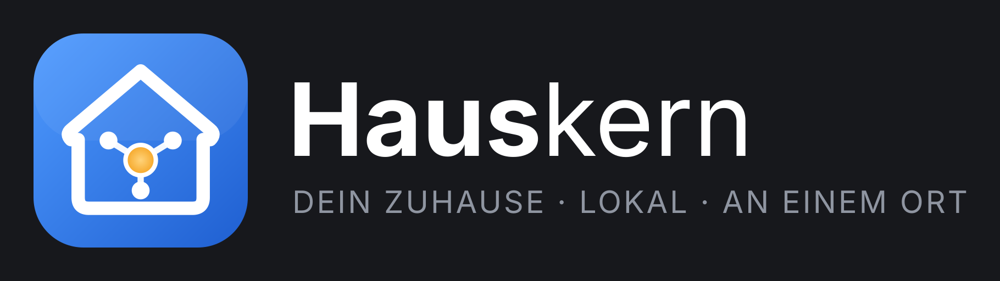

# Hauskern – dein Zuhause, lokal, an einem Ort 🏠

Hauskern ist eine kostenlose Smart-Home-Zentrale für Windows, Mac und Linux, die **komplett bei dir zu Hause** läuft:
ohne Cloud, ohne Konto, ohne Abo. Am meisten kann Hauskern mit einer FRITZ!Box, andere Router gehen aber auch.

> ⚠️ Hauskern ist ein unabhängiges Hobby-Projekt, freie Software unter der **GPL-3.0** und kommt **ohne jede Gewähr**.
> Bitte vorher [RECHTLICHES.txt](RECHTLICHES.txt) lesen, besonders die Sicherheitshinweise.

## Was Hauskern kann ✨

- **Netzwerk:** Geräte im Heimnetz, WLAN & Gast-WLAN mit QR-Code, Internet-Status, Wake-on-LAN, mehrere FRITZ!Boxen/Mesh
- **Smart Home:** FRITZ!DECT-Steckdosen und Heizkörper, Shelly, Philips Hue, Tasmota, ESPHome, Zigbee (Zigbee2MQTT)
- **3D-Druck:** Bambu Lab Drucker mit Status, AMS, Kamera, Druckkosten, Filament-Lager, Zeitraffer, Fehldruck-Wächter
- **Kameras:** ONVIF-Kameras (z. B. Tapo), Bewegungserkennung, optionale KI-Erkennung (Person, Tier, Fahrzeug)
- **Automationen:** eigene Regeln mit Bedingungen, Anwesenheit über das Heim-WLAN, Urlaubsmodus, „Waschmaschine fertig“
- **Alltag:** Kalender, Wetter & DWD-Unwetterwarnungen, Einkaufsliste, Wand-Display, Anrufliste, Energie-Übersicht
- **Handy:** Weboberfläche fürs Handy (per QR-Code wie eine App), mehrere Nutzer mit Rechten, Zwei-Faktor-Anmeldung (Authenticator-App + Notfallcodes), Siri-Kurzbefehle, Push per Telegram
- **Heimserver:** läuft auf Wunsch rund um die Uhr auf einem Raspberry Pi oder Mini-PC mit Linux

## Installieren 🚀

1. Unter **[Releases](../../releases)** die neueste `Consumer-Hauskern-<version>.zip` herunterladen.
2. Entpacken und der **[ANLEITUNG.txt](ANLEITUNG.txt)** folgen. Unter Windows reicht ein Doppelklick auf `Hauskern-Setup.cmd`.
3. Für einen Heimserver (Pi/Mini-PC) gibt es die **[ANLEITUNG-HEIMSERVER.txt](ANLEITUNG-HEIMSERVER.txt)**.

Hauskern braucht nur **Python 3** (kostenlos von python.org), sonst keine Zusatzpakete.

**Updates:** einfach die neue ZIP in den Download-Ordner legen (nicht entpacken) und Hauskern starten. Jedes Update
ist **digital unterschrieben**: Hauskern prüft das vor der Installation und lehnt veränderte Pakete ab.

## Sicherheit 🔒

- Hauskern **nie per Portfreigabe ins Internet stellen.** Von unterwegs nur über ein VPN (z. B. FRITZ!Box-VPN, WireGuard).
- Bambu-Lab-Drucker lassen sich von fremder Software nur im **LAN-Modus** mit eingeschaltetem **Entwicklermodus**
  steuern (siehe ANLEITUNG.txt, Teil D).

## Etwas klappt nicht? 🐞

In Hauskern unter **⋯ Mehr → 🐞 Problem melden** (am Handy: ⚙ → Problem melden). Damit öffnet sich eine fertig
ausgefüllte Meldung hier unter **[Issues](../../issues)**. Adressen, Namen und Passwörter werden vorher entfernt.

## Unterstützen ❤️

Hauskern ist und bleibt kostenlos. Wer das Projekt unterstützen möchte, kann oben auf **„Sponsor“** klicken.
Vielen Dank! Spenden sind freiwillig und ändern nichts an den Funktionen.

## Lizenz 📜

Copyright (C) 2026 Die Hauskern-Autoren

Dieses Programm ist freie Software: Du kannst es unter den Bedingungen der **GNU General Public License**, Version 3
oder (nach deiner Wahl) jeder späteren Version, weitergeben und/oder verändern. Es wird in der Hoffnung verbreitet,
dass es nützlich ist, aber **ohne jede Gewährleistung**. Details: [LICENSE.txt](LICENSE.txt) ·
Fremdsoftware, Datenschutz & Marken: [RECHTLICHES.txt](RECHTLICHES.txt)

*FRITZ!, Bambu Lab, Tapo, Shelly, Philips Hue und alle anderen genannten Namen sind Marken ihrer Inhaber.
Hauskern ist kein offizielles Produkt dieser Hersteller.*
